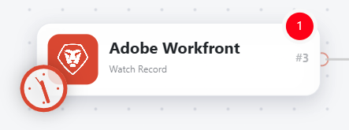

# Hinzufügen eines Auslösermoduls zu einem Basisszenario

Trigger-Module werden am Anfang eines Szenarios platziert. Diese Module beginnen die Ausführung eines Szenarios, wenn eine Änderung in einem bestimmten Service stattgefunden hat. Bei der Änderung kann es sich um die Erstellung neuer Datensätze, das Löschen von Datensätzen, die Aktualisierung von Datensätzen usw. handeln. Sie legen die Kriterien für die Änderungen fest, die mit dem Szenario beginnen.

Abfragemodule überprüfen den Service in einem bestimmten Zeitintervall und geben Informationen zu Änderungen zurück, die während dieses Zeitintervalls aufgetreten sind. Wenn keine Änderungen vorgenommen wurden, führt der Trigger das Szenario nicht aus.

In diesem Beispiel fügen Sie ein Trigger -Modul hinzu, das alle 15 Minuten ausgeführt wird und ein Szenario startet, wenn Anforderungen an eine bestimmte Warteschlange gesendet wurden. Das Szenario konvertiert diese Anfragen dann in ein Projekt.

Dieses Beispiel ändert das in erstellte Szenario [Erstellen eines einfachen Szenarios](/help/workfront-fusion/build-practice-scenarios/create-basic-scenario.md).

>[!NOTE]
>
>Workfront Fusion stellt den Szenario-Editor auf ein neues Erlebnis um. Während dieser Umstellung sind sowohl die klassischen als auch die neuen Erlebnisse verfügbar und Sie können jederzeit zwischen ihnen wechseln. Es wird empfohlen, die neue -Version zu verwenden. Weitere Informationen finden Sie unter [Neue und klassische Erlebnisse](/help/workfront-fusion/get-started-with-fusion/navigate-fusion/scenario-editor.md#new-and-classic-experiences) im Artikel Szenario-Editor.

## Zugriffsanforderungen

+++ Erweitern, um die Zugriffsanforderungen für die in diesem Artikel beschriebene Funktionalität anzuzeigen.

<table style="table-layout:auto">
 <col> 
 <col> 
 <tbody> 
  <tr> 
   <td role="rowheader">Adobe Workfront-Paket</td> 
   <td> 
Ein beliebiges Adobe Workfront Workflow- und Adobe Workfront Automation and Integration-Paket

Workfront Ultimate

Workfront Prime- und Select-Pakete bei zusätzlichem Kauf von Workfront Fusion.
 </td> 
  </tr> 
  <tr data-mc-conditions=""> 
   <td role="rowheader">Adobe Workfront-Lizenzen</td> 
   <td> 
Standard

Work oder höher
 </td> 
  </tr> 
  <tr> 
   <td role="rowheader">Produkt</td> 
   <td>
   
Wenn Ihre Organisation über ein Workfront Select- oder Prime-Paket ohne Workfront Automation and Integration verfügt, muss Ihre Organisation Adobe Workfront Fusion erwerben.</li></ul>
   </td> 
  </tr>
 </tbody> 
</table>

Weitere Details zu den Informationen in dieser Tabelle finden Sie unter [Zugriffsanforderungen in der Dokumentation](/help/workfront-fusion/references/licenses-and-roles/access-level-requirements-in-documentation.md).

+++

## Voraussetzungen

Sie müssen das unter &quot;[&#x200B; eines einfachen Szenarios“ beschriebene Szenario erstellen](/help/workfront-fusion/build-practice-scenarios/create-basic-scenario.md) bevor Sie dieses Verfahren ausführen.

## Hinzufügen und Konfigurieren des Trigger-Moduls in der neuen -Version (empfohlen)

* [Hinzufügen des Trigger-Moduls](#add-the-trigger-module)
* [Planen des Trigger-Moduls](#schedule-the-trigger-module)
* [Aktualisieren des zweiten Moduls](#update-the-second-module)
* [Testen und Aktivieren](#test-and-activate)

### Hinzufügen des Trigger-Moduls

1. Öffnen Sie das Szenario im Szenario-Editor.
1. Klicken Sie mit der rechten Maustaste auf das erste Modul (Suche) und wählen Sie **[!UICONTROL Modul löschen]**.

   Das Modul wird gelöscht, wobei ein leerer Platzhalter verbleibt.

1. Klicken Sie auf das leere Modul, um die Liste der Apps und Services zu öffnen.

   

1. **Adobe Workfront**.
1. Wählen Sie **Eintrag beobachten**.
1. Stellen Sie sicher, dass das Modul dieselbe Verbindung wie die übrigen Module im Szenario verwendet.
1. Wählen Sie im Feld Datensatztyp die Option **Problem** aus.
1. Wählen Sie im Feld Filter die Option **Nur neue Datensätze** aus.
1. Wählen Sie im Feld Ausgaben die Optionen `ID`, `Name` und `Project ID` aus.
1. Klicken Sie **OK**, um die Moduleinstellungen zu speichern.

   Das Fenster Start auswählen wird angezeigt.

1. Wählen Sie **Von jetzt an**.

### Planen des Trigger-Moduls

1. Klicken Sie auf das Uhrensymbol im Modul Aufzeichnung ansehen .

   

   Das Zeitplaneinstellungsfenster wird geöffnet.

1. Wählen Sie im Feld Ausführungsszenario die Option **In regelmäßigen Abständen** aus.

1. Klicken Sie auf **OK**.

### Aktualisieren des zweiten Moduls

Da das erste Modul ersetzt wurde, muss das zweite Modul dem neuen ersten Modul zugeordnet werden.

1. Öffnen Sie das Modul Objekt konvertieren .
1. Löschen Sie im Feld „Anfrage-ID“ den Block „Schwarze ID“. Der Block ist schwarz, da das Modul, von dem aus er zugeordnet wurde, nicht mehr verfügbar ist.
1. Wählen Sie den ID-Block unter dem ersten Modul (Überwachungsdatensatz) aus, um ihn dem zweiten Modul zuzuordnen.
1. Klicken Sie auf **OK**.

### Testen und Aktivieren

1. Wechseln Sie zur Workfront-Umgebung, mit der sich Fusion verbindet, und fügen Sie ein Problem hinzu.
1. Klicken Sie auf **[!UICONTROL Symbol „Einmal]**&quot;.

   „Einmal ausführen“ ist in der neuen -Version nur als Symbol verfügbar. Bewegen Sie den Mauszeiger über das Symbol, um die QuickInfo **[!UICONTROL Einmal ausführen]** anzuzeigen.

   

1. Überprüfen Sie die Ausgabe, um sicherzustellen, dass das Szenario erwartungsgemäß ausgeführt wurde.
1. Wenn Sie sich vergewissert haben, dass das Szenario erwartungsgemäß funktioniert, klicken Sie auf den Umschalter **Planung**, um **Ein**.

   Dadurch wird das Szenario aktiviert.

   

1. Klicken Sie auf **Speichern**-Symbol  im Bereich Steuerelemente , um den Fortschritt des Szenarios zu speichern.

   >[!IMPORTANT]
   >
   >Speichern Sie häufig, während Sie ein Szenario verfeinern und testen.

## Hinzufügen und Konfigurieren des Trigger-Moduls in der klassischen Benutzeroberfläche

* [Hinzufügen des Trigger-Moduls (Classic)](#add-the-trigger-module-classic)
* [Planen des Trigger-Moduls (Classic)](#schedule-the-trigger-module-classic)
* [Aktualisieren des zweiten Moduls (Classic)](#update-the-second-module-classic)
* [Testen und Aktivieren (klassisch)](#test-and-activate-classic)

### Hinzufügen des Trigger-Moduls (Classic)

1. Öffnen Sie das Szenario im Szenario-Editor.
1. Klicken Sie mit der rechten Maustaste auf das erste Modul (Suche) und wählen Sie **Modul löschen**.

   Das Modul wird gelöscht, wobei ein leerer Platzhalter verbleibt.

1. Klicken Sie auf das leere Modul und wählen Sie **Adobe Workfront** aus der Liste der Apps aus.
1. Wählen Sie **Eintrag beobachten**.
1. Stellen Sie sicher, dass das Modul dieselbe Verbindung wie die übrigen Module im Szenario verwendet.
1. Wählen Sie im Feld Datensatztyp die Option **Problem** aus.
1. Wählen Sie im Feld Filter die Option **Nur neue Datensätze** aus.
1. Wählen Sie im Feld Ausgaben die Optionen `ID`, `Name` und `Project ID` aus.
1. Klicken Sie **OK**, um die Moduleinstellungen zu speichern.

   Das Fenster Start auswählen wird angezeigt.

1. Wählen Sie **Von jetzt an**.

### Planen des Trigger-Moduls (Classic)

1. Klicken Sie auf die Uhr im Modul „Uhr-Aufnahme“.

   Das Zeitplaneinstellungsfenster wird geöffnet.

1. Wählen Sie im Feld Ausführungsszenario die Option **In regelmäßigen Abständen** aus.

1. Klicken Sie auf **OK**.

### Aktualisieren des zweiten Moduls (Classic)

Da das erste Modul ersetzt wurde, muss das zweite Modul dem neuen ersten Modul zugeordnet werden.

1. Öffnen Sie das Modul Objekt konvertieren .
1. Löschen Sie im Feld „Anfrage-ID“ den Block „Schwarze ID“. Der Block ist schwarz, da das Modul, von dem aus er zugeordnet wurde, nicht mehr verfügbar ist.
1. Wählen Sie den ID-Block unter dem ersten Modul (Überwachungsdatensatz) aus, um ihn dem zweiten Modul zuzuordnen.
1. Klicken Sie auf **OK**.

### Testen und Aktivieren (klassisch)

1. Wechseln Sie zur Workfront-Umgebung, mit der sich Fusion verbindet, und fügen Sie ein Problem hinzu.
1. Klicken Sie **[!UICONTROL Einmal ausführen]** in der linken unteren Ecke des Szenario-Editors.
1. Überprüfen Sie die Ausgabe, um sicherzustellen, dass das Szenario erwartungsgemäß ausgeführt wurde.
1. Wenn Sie sich vergewissert haben, dass das Szenario erwartungsgemäß funktioniert, klicken Sie auf **Umschalter** Planung“ unten links im Bildschirm auf **Ein**.

   Dadurch wird das Szenario aktiviert.
1. Klicken Sie in Workfront Fusion auf **[!UICONTROL Speichern]** unten links, um Ihren Fortschritt im Szenario zu speichern.

   >[!IMPORTANT]
   >
   >Speichern Sie häufig, während Sie ein Szenario verfeinern und testen.

## Ressourcen

* Weitere Informationen zu Trigger-Modulen finden Sie unter [Trigger-Module](/help/workfront-fusion/get-started-with-fusion/understand-fusion/module-overview.md#trigger-modules) im Artikel Module - Übersicht.
