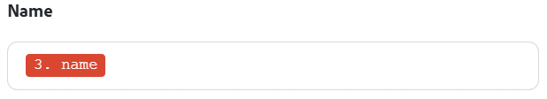

# Überblick über Zuordnungen

Beim Zuordnen werden die Ausgaben eines Moduls den Eingabefeldern eines anderen Moduls zugewiesen.

Bei Verwendung eines Moduls werden kein, ein oder mehrere Pakete als Ausgabe erzeugt. Ein Paket besteht aus einem oder mehreren Elementen.

Sie können diese Elemente Feldern in späteren Modulen zuordnen.

>[!NOTE]
>
>Workfront Fusion stellt den Szenario-Editor auf ein neues Erlebnis um. Während dieser Umstellung sind sowohl die klassischen als auch die neuen Erlebnisse verfügbar und Sie können jederzeit zwischen ihnen wechseln. Es wird empfohlen, die neue -Version zu verwenden. Weitere Informationen finden Sie unter [Neue und klassische Erlebnisse](/help/workfront-fusion/get-started-with-fusion/navigate-fusion/scenario-editor.md#new-and-classic-experiences) im Artikel Szenario-Editor.

Wenn Sie auf ein Feld klicken, in das ein Wert eingefügt werden kann, der von einem vorherigen Modul in einem Szenario ausgegeben wurde, wird das Zuordnungs-Panel angezeigt. Hier können Sie das Element auswählen, das zugeordnet werden soll. Eine Zuordnung kann eines oder mehrere der folgenden Objekte umfassen:

* ein einziges Element
* mehrere Elemente
* statischen Text
* Funktionen

>[!BEGINSHADEBOX]

**Beispiele**:

Ein einziges Element

Mehrere Elemente mit Text

Funktion mit mehreren Elementen und Text

>[!ENDSHADEBOX]

Anweisungen zum Zuordnen finden Sie in den Artikeln unter [Zuordnen von Daten: Artikelindex](/help/workfront-fusion/create-scenarios/map-data/map-data-toc.md).

>[!NOTE]
>
>Auf Ausgaben von Modulen, die zwischen [!UICONTROL Iterator] und [!UICONTROL Aggregator] eingeschlossen sind, kann nur über das Modul [!UICONTROL Aggregator] zugegriffen werden.

## Das Zuordnungs-Panel

Wenn Sie in ein Feld klicken, in dem Sie Daten zuordnen können, wird das Zuordnungs-Panel geöffnet.

Auf der ersten Registerkarte werden die Elemente angezeigt, die Sie aus anderen Modulen zuordnen können.

Die anderen Registerkarten umfassen Funktionen, Operatoren und Keywords, mit denen Sie Formeln erstellen können. Diese sind je nach Datentyp in verschiedene Registerkarten unterteilt.

Weitere Informationen zu Funktionsregisterkarten finden Sie unter [Überblick über Funktionen](/help/workfront-fusion/get-started-with-fusion/understand-fusion/function-overview.md).

Weitere Informationen zum Zuordnen von Elementen mithilfe von Funktionen [&#x200B; Sie unter „Zuordnen von Elementen mithilfe integrierter Funktionen](/help/workfront-fusion/create-scenarios/map-data/map-using-functions.md).

## Sammlungen

Elemente können mehrere Werte verschiedener Typen enthalten. Dies sind Elemente vom Typ „Sammlung“.

Pakete vom Typ „Sammlung“ `(Collection)` werden in der Modulausgabe neben dem Paket-Label angezeigt.

In den meisten Fällen ordnen Sie die Elemente der Sammlung zu und nicht das Element, das für die gesamte Sammlung steht.

Um das Element einer Sammlung im Zuordnungs-Panel zu finden, klicken Sie auf den Pfeil neben der Sammlung.

Weitere Informationen zu Sammlungen finden Sie unter [Elementdatentypen](/help/workfront-fusion/references/mapping-panel/data-types/item-data-types.md).

Anweisungen zum Zuordnen von Sammlungen finden Sie unter [Zuordnen eines Elements](/help/workfront-fusion/create-scenarios/map-data/map-data-from-one-to-another.md#map-an-item) im Artikel „Zuordnen von Informationen zwischen Modulen“.

## Arrays

Elemente können mehrere Werte desselben Typs enthalten. Dies sind Elemente vom Typ „Array“.

Pakete vom Typ „Array“ `(Array)` werden in der Modulausgabe neben dem Paket-Label angezeigt.

Im Zuordnungsbereich werden Arrays mit eckigen Klammern angezeigt. Sie können ein Element vom Typ Array durch die eckigen Klammern am Ende der Beschriftung des Elements identifizieren. Um ein bestimmtes Array-Element im Zuordnungsbereich zu finden, klicken Sie auf den Pfeil neben dem Array.

Informationen und Anweisungen zum Zuordnen von Arrays und Array-Elementen finden Sie unter [Zuordnen von Arrays und Array-Elementen](/help/workfront-fusion/create-scenarios/map-data/map-an-array.md).
