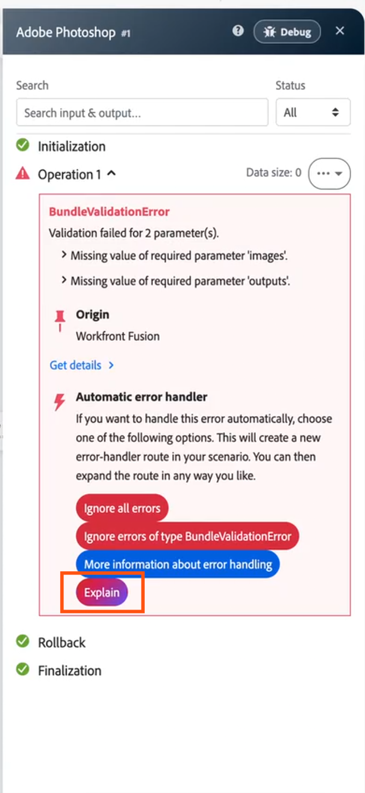

# Erläuterung eines Szenariofehlers mit KI

Wenn ein Szenario fehlschlägt, kann KI Ihnen eine kurze, einfache Beschreibung dessen geben, was schiefgelaufen ist und wie dies behoben werden kann. Die Erklärung wird neben dem ursprünglichen Fehler angezeigt, sodass Sie beide zusammen lesen können.

Fehler können in den folgenden Bereichen von Workfront Fusion erklärt werden:

* Details zu Modulfehlern im Szenario-Designer
* Die Ausführungsdetails im Ausführungsverlauf eines Szenarios
* Die Tabelle [!UICONTROL Fehlgeschlagene Ausführungsprotokolle] auf der Seite „Insights“

>[!NOTE]
>
>Die **[!UICONTROL Erläutern]**-Schaltfläche ist nur im neuen Szenario-Designer verfügbar. Sie ist nicht im alten Szenario-Designer verfügbar.

## Zugriffsanforderungen

+++ Erweitern, um die Zugriffsanforderungen für die in diesem Artikel beschriebene Funktionalität anzuzeigen.

<table style="table-layout:auto">
 <col> 
 <col> 
 <tbody> 
  <tr> 
   <td role="rowheader">Adobe Workfront-Paket</td> 
   <td> 
Ein beliebiges Adobe Workfront Workflow- und Adobe Workfront Automation and Integration-Paket

Workfront Ultimate

Workfront Prime- und Select-Pakete bei zusätzlichem Kauf von Workfront Fusion.
 </td> 
  </tr> 
  <tr data-mc-conditions=""> 
   <td role="rowheader">Adobe Workfront-Lizenzen</td> 
   <td> 
Standard

Work oder höher
 </td> 
  </tr> 
  <tr> 
   <td role="rowheader">Produkt</td> 
   <td>
   
Wenn Ihre Organisation über ein Workfront Select- oder Prime-Paket ohne Workfront Automation and Integration verfügt, muss Ihre Organisation Adobe Workfront Fusion erwerben.

   </td> 
  </tr>
 </tbody> 
</table>

Weitere Details zu den Informationen in dieser Tabelle finden Sie unter [Zugriffsanforderungen in der Dokumentation](/help/workfront-fusion/references/licenses-and-roles/access-level-requirements-in-documentation.md).

+++

## Erklären Sie einen Fehler in den Details zur Modulausgabe

1. Klicken Sie auf **[!UICONTROL Registerkarte]** Szenarien“ im linken Bedienfeld.
1. Wählen Sie das Szenario aus, in dem Sie einen Fehler erklären möchten.
1. Klicken Sie auf eine beliebige Stelle im Szenario, um den Szenario-Editor aufzurufen.
1. Führen Sie das Szenario entweder wie geplant aus oder indem Sie auf **Einmal ausführen** klicken.
1. Wenn ein Modul fehlschlägt, öffnen Sie die Fehlerdetails des Moduls.
1. Klicken Sie auf **[!UICONTROL Erläuterung]**.

   Die Schaltfläche befindet sich unter dem Fehler.

   

Die Erklärung wird unter dem Fehler angezeigt.

>[!NOTE]
>
> * Während AI die Erklärung generiert, wird ein Ladestatus angezeigt.
> * Wenn die Erklärung nicht generiert werden kann, klicken Sie auf **[!UICONTROL Erneut versuchen]**.
> * Wenn Ihr Unternehmen die KI-Nutzungsbeschränkung erreicht, wird anstelle einer Erklärung eine Meldung zur Nutzungsbeschränkung angezeigt.

## Erklären eines Fehlers im Ausführungsverlauf eines Szenarios

1. Klicken Sie auf **[!UICONTROL Registerkarte]** Szenarien“ im linken Bereich und klicken Sie dann auf das Szenario.
1. Klicken Sie **[!UICONTROL Verlauf]** neben dem Namen des Szenarios.
1. Klicken Sie auf die fehlgeschlagene Ausführung, die Sie anzeigen möchten.

   Jeder Fehler in den Ausführungsdetails hat eine Schaltfläche **[!UICONTROL Erläutern]** darunter.

1. Klicken **[!UICONTROL unter]** Fehler, den Sie erläutern möchten, auf „Erläutern“.

   Wenn mehrere Module in der Ausführung fehlschlugen, können Sie jeden Fehler einzeln erklären.

   

Weitere Informationen zum Anzeigen einer Ausführung finden Sie unter [Anzeigen des Ausführungsverlaufs eines Szenarios](/help/workfront-fusion/manage-scenarios/view-scenario-execution-history.md) und [Anzeigen der Ausführung eines bestimmten Szenarios](/help/workfront-fusion/manage-scenarios/view-a-specific-scenario-execution.md).

>[!NOTE]
>
> * Während AI die Erklärung generiert, wird ein Ladestatus angezeigt.
> * Wenn die Erklärung nicht generiert werden kann, klicken Sie auf **[!UICONTROL Erneut versuchen]**.
> * Wenn Ihr Unternehmen die KI-Nutzungsbeschränkung erreicht, wird anstelle einer Erklärung eine Meldung zur Nutzungsbeschränkung angezeigt.

## Erklären Sie einen Fehler auf der Seite „Insights“

1. Klicken Sie in Fusion **[!UICONTROL linken]** auf „Insights“.
1. Bewegen Sie in [!UICONTROL &#x200B; Tabelle „Fehlgeschlagene &#x200B;]&quot; den Mauszeiger über die fehlerhafte Zeile, die Sie anzeigen möchten.

   Eine **[!UICONTROL Erläutern]**-Schaltfläche wird angezeigt.

1. Klicken Sie auf **[!UICONTROL Erläuterung]**.

   

   Ein Popup wird geöffnet, in dem der Fehler und die KI-Erklärung angezeigt werden.

Weitere Informationen zur Insights-Seite finden Sie unter [Anzeigen des Insights-Dashboards für eine Organisation](/help/workfront-fusion/set-up-and-manage-workfront-fusion/set-up-and-manage-orgs-and-teams/set-up-orgs-teams-and-users/view-insights-dashboard.md).

>[!NOTE]
>
> * Während AI die Erklärung generiert, wird ein Ladestatus angezeigt.
> * Wenn die Erklärung nicht generiert werden kann, klicken Sie auf **[!UICONTROL Erneut versuchen]**.
> * Wenn Ihr Unternehmen die KI-Nutzungsbeschränkung erreicht, wird anstelle einer Erklärung eine Meldung zur Nutzungsbeschränkung angezeigt.
