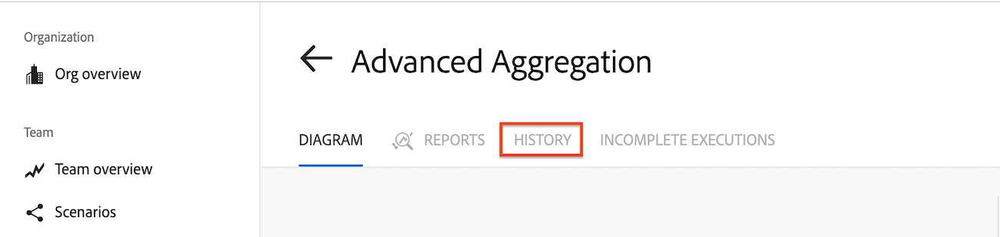
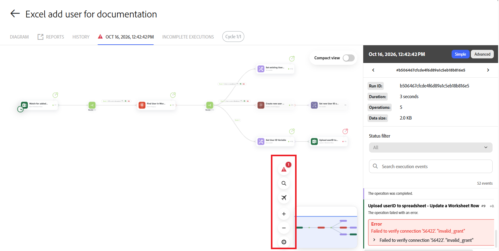

# Anzeigen einer bestimmten Szenario-Ausführung

Sie können Details zu einer bestimmten Szenario-Ausführung anzeigen, einschließlich Filtern und Suchen nach Szenario-Ereignissen.

## Zugriffsanforderungen

+++ Erweitern, um die Zugriffsanforderungen für die in diesem Artikel beschriebene Funktionalität anzuzeigen.

<table style="table-layout:auto">
 <col> 
 <col> 
 <tbody> 
  <tr> 
   <td role="rowheader">Adobe Workfront-Paket</td> 
   <td> 
Ein beliebiges Adobe Workfront Workflow- und Adobe Workfront Automation and Integration-Paket

Workfront Ultimate

Workfront Prime- und Select-Pakete bei zusätzlichem Kauf von Workfront Fusion.
 </td> 
  </tr> 
  <tr data-mc-conditions=""> 
   <td role="rowheader">Adobe Workfront-Lizenzen</td> 
   <td> 
Standard

Work oder höher
 </td> 
  </tr> 
  <tr> 
   <td role="rowheader">Produkt</td> 
   <td>
   
Wenn Ihre Organisation über ein Workfront Select- oder Prime-Paket ohne Workfront Automation and Integration verfügt, muss Ihre Organisation Adobe Workfront Fusion erwerben.</li></ul>
   </td> 
  </tr>
 </tbody> 
</table>

Weitere Details zu den Informationen in dieser Tabelle finden Sie unter [Zugriffsanforderungen in der Dokumentation](/help/workfront-fusion/references/licenses-and-roles/access-level-requirements-in-documentation.md).

+++

## Anzeigen einer bestimmten Ausführung

Sie können eine Ausführung aus dem Szenarioverlauf des Szenarios anzeigen.

1. Klicken Sie auf **[!UICONTROL Registerkarte]** Szenarien“ im linken Bereich und klicken Sie dann auf das Szenario.

   ODER

   Wenn Sie das Szenario im Szenario-Editor bearbeiten, klicken Sie auf den Pfeil nach links  in der oberen linken Ecke des Fensters.

1. Klicken Sie **Verlauf** neben dem Namen des Szenarios.
   

1. Suchen Sie die Ausführung, die Sie anzeigen möchten, und klicken **ganz rechts in der Zeile für** Ausführung auf „Details“. Der [!UICONTROL details]-Link ist nur sichtbar, wenn für die Ausführung Details verfügbar sind.

   Das Szenario-Diagramm wird geöffnet, wobei rechts das Bedienfeld Ausführungsdetails geöffnet ist.

   Module, die eine Ausgabe für diese Ausführung erzeugt haben, sind mit grünen Titeln gekennzeichnet.

   Module, die nicht ausgeführt wurden, sind abgeblendet.

1. Um die Ausgabe eines Moduls anzuzeigen, klicken Sie auf die Blase Ausgabedetails neben dem Modul. Die Zahl in der Bubble gibt die Anzahl der Bundles an, die vom Modul ausgegeben werden.

   

1. Um die Bundles anzuzeigen, die einen Filter durchlaufen haben, klicken Sie auf den Filter. Die Zahl in der Nähe des Filters gibt die Anzahl der Bundles an, die den Filter passiert haben.
1. Um im Ausführungsbereich nach einem bestimmten Modul oder Ereignis zu suchen, geben Sie den Suchbegriff in das Feld **Ausführungsereignisse suchen** ein. Die Ergebnisse werden während der Eingabe angezeigt.
1. Um die Suchergebnisse des Ausführungsbereichs nach Status wie Erfolg oder Warnung zu begrenzen, klicken Sie auf das **Statusfilter** und wählen Sie den Status aus.

>[!NOTE]
>
>Um einen Link zu einem bestimmten Modul zu erstellen, fügen Sie bei der Anzeige der folgenden Seiten `?moduleId=<module-id>` zur URL hinzu:
>
>* Szenario-Bearbeitungsseite (URL endet in `/edit`)
>* Bestimmte Szenario-Ausführung (URL endet in `/logs/<log-id>`)
>
>`<module-id>` bezieht sich auf die Zahl neben der Modulbeschriftung beim Anzeigen des Szenarios.
>
>Dies kann beim Debuggen von Szenarien oder beim Kopieren der Modulkonfiguration nützlich sein.

## Überprüfen einer Ausführung im neuen Szenario-Editor

Wenn Sie in der neuen -Version eine Ausführung über den Ausführungsverlauf öffnen, können Sie mit den Steuerelementen auf der rechten Seite der Arbeitsfläche den Fehler finden, ohne das Szenario zu bearbeiten:

| Kontrollvariante | Details |
| ---------- | ---------- |
| Zum nächsten Fehler oder Warnhinweis gehen | Zeigt an, bei wie vielen Modulen im aktuellen Zyklus ein Problem aufgetreten ist. Jeder Klick bewegt sich zum nächsten, zuerst zu Fehlern und dann zu Warnungen, von links nach rechts. Das Modul wird zentriert und der erste fehlgeschlagene Vorgang wird geöffnet. Die Schaltfläche wird ausgeblendet, wenn bei der Ausführung keine Fehler oder Warnungen aufgetreten sind. |
| Suchmodule | Suchen Sie ein Modul nach Namen und zentrieren Sie es auf der Arbeitsfläche. Drücken Sie Strg+K (Windows) oder Befehl+K (Mac). |
| Anmerkungen | Ein- oder Ausblenden der Notizen des Szenarios. Dieses Steuerelement wird nur angezeigt, wenn das Szenario Anmerkungen enthält und die Anmerkungen hier schreibgeschützt sind. |
| Fluss erläutern | Die Reihenfolge der Ausführung der Module des Szenarios animieren. Klicken Sie erneut darauf oder drücken Sie Esc, um den Vorgang zu beenden. |
| Vergrößern, Verkleinern, Fokus und Minikarte | Arbeiten Sie auf die gleiche Weise wie im Bearbeitungsmodus. |

Der **Compact view**-Schalter ist auch in der oberen rechten Ecke verfügbar. Wenn Sie eine Ausführung überprüfen, wird das Layout nur geändert, während Sie diese Ausführung betrachten. Die Einstellung der kompakten Ansicht wird zur Bearbeitung nicht geändert, und es wird nichts im Szenario gespeichert.

Wählen Sie ein Ereignis aus der Ausführung aus, um es zu zentrieren, und markieren Sie das entsprechende Modul. Wenn Vorgangsdetails verfügbar sind, wird das Bedienfeld „Anfrage“ und „Antwort“ geöffnet. Wenn das Bedienfeld keine Daten enthält, wurden Anfrage- und Antwortdetails für diese Ausführung nicht beibehalten. Informationen zum Erfassen dieser Daten für zukünftige Ausführungen finden Sie unter [Temporäre Debug-Protokolle](/help/workfront-fusion/create-scenarios/config-scenarios-settings/configure-scenario-settings.md#temporary-debug-logs).
