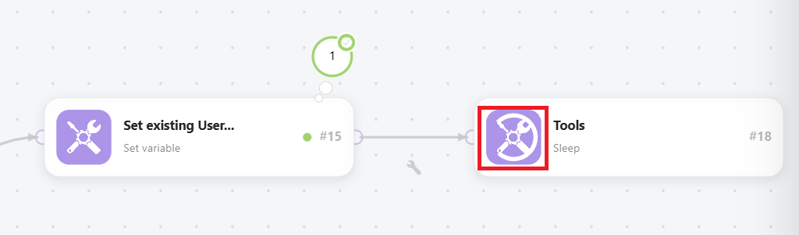

# Anzeigen des Datenflusses in einem laufenden Szenario

Sie können sich ein laufendes Szenario ansehen, um zu sehen, wie Daten durch es fließen.

>[!NOTE]
>
>Workfront Fusion stellt den Szenario-Editor auf ein neues Erlebnis um. Während dieser Umstellung sind sowohl die klassischen als auch die neuen Erlebnisse verfügbar und Sie können jederzeit zwischen ihnen wechseln. Es wird empfohlen, die neue -Version zu verwenden. Weitere Informationen finden Sie unter [Neue und klassische Erlebnisse](/help/workfront-fusion/get-started-with-fusion/navigate-fusion/scenario-editor.md#new-and-classic-experiences) im Artikel Szenario-Editor.

Während der Ausführung eines Szenarios wird das aktive Modul durch einen rotierenden Ring auf dem Symbol des Moduls in der neuen -Version oder durch einen wachsenden Ring um das Modul in der klassischen -Version gekennzeichnet. Der Ring zeigt nur an, dass das Modul ausgeführt wird, nicht der Fortschritt. Module, die schnell laufen, zeigen möglicherweise nur einen kleinen Teil des Rings an.

Neue Erfahrung

Klassische Erfahrung

Nach Ausführung des Moduls erscheint eine Ausgabeanzeige.

Neue Erfahrung

Klassische Erfahrung

Wenn das Modul mehr als ein Bundle verarbeitet, wird der Ring für jedes verarbeitete Bundle angezeigt, und die Ausgabeanzeige zählt für jedes Bundle, das es ausgibt.

Weitere Informationen zum Szenario-Datenfluss finden Sie unter [Szenario-Ausführungsfluss](/help/workfront-fusion/references/scenarios/scenario-execution-flow.md).

## Zugriffsanforderungen

+++ Erweitern, um die Zugriffsanforderungen für die in diesem Artikel beschriebene Funktionalität anzuzeigen.

<table style="table-layout:auto">
 <col> 
 <col> 
 <tbody> 
  <tr> 
   <td role="rowheader">Adobe Workfront-Paket</td> 
   <td> 
Ein beliebiges Adobe Workfront Workflow- und Adobe Workfront Automation and Integration-Paket

Workfront Ultimate

Workfront Prime- und Select-Pakete bei zusätzlichem Kauf von Workfront Fusion.
 </td> 
  </tr> 
  <tr data-mc-conditions=""> 
   <td role="rowheader">Adobe Workfront-Lizenzen</td> 
   <td> 
Standard

Work oder höher
 </td> 
  </tr> 
  <tr> 
   <td role="rowheader">Produkt</td> 
   <td>
   
Wenn Ihre Organisation über ein Workfront Select- oder Prime-Paket ohne Workfront Automation and Integration verfügt, muss Ihre Organisation Adobe Workfront Fusion erwerben.</li></ul>
   </td> 
  </tr>
 </tbody> 
</table>

Weitere Details zu den Informationen in dieser Tabelle finden Sie unter [Zugriffsanforderungen in der Dokumentation](/help/workfront-fusion/references/licenses-and-roles/access-level-requirements-in-documentation.md).

+++

## Anzeigen des Datenflusses in einem laufenden Szenario

1. Klicken Sie auf **[!UICONTROL Registerkarte]** Szenarien“ im linken Bedienfeld.
1. Wählen Sie das Szenario aus, in dem Sie den Datenfluss anzeigen möchten.
1. Klicken Sie auf eine beliebige Stelle im Szenario, um den Szenario-Editor aufzurufen.
1. Wenn das Szenario nicht ausgeführt wird, aktivieren Sie es oder klicken Sie auf **Einmal ausführen** um die Ausführung des Szenarios zu starten.
1. Wählen Sie die Ausführung, die Sie anzeigen möchten, im Abschnitt „Derzeit läuft“ des Bedienfelds Ausführungsverlauf aus.

